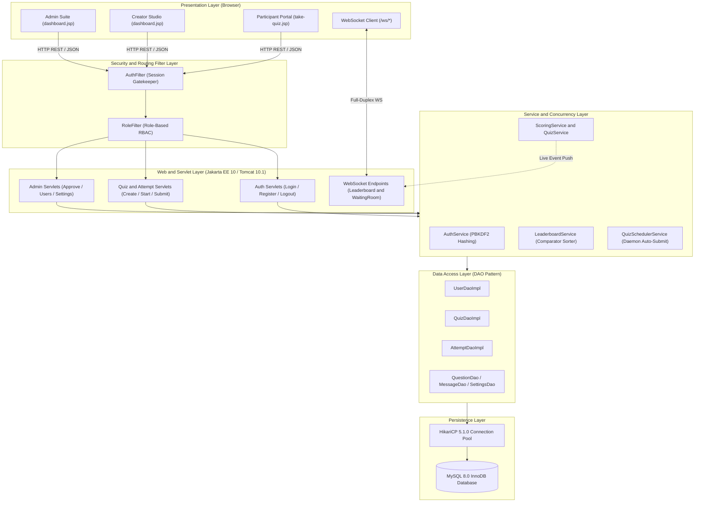
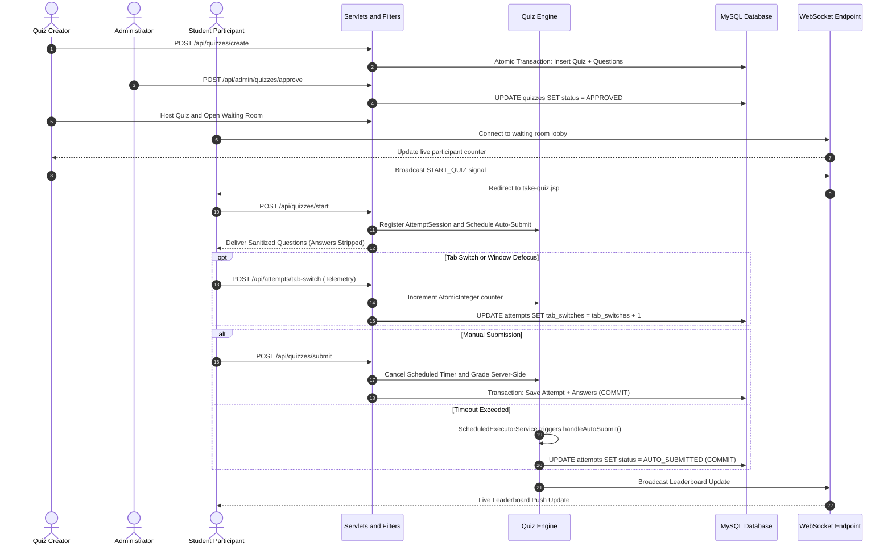
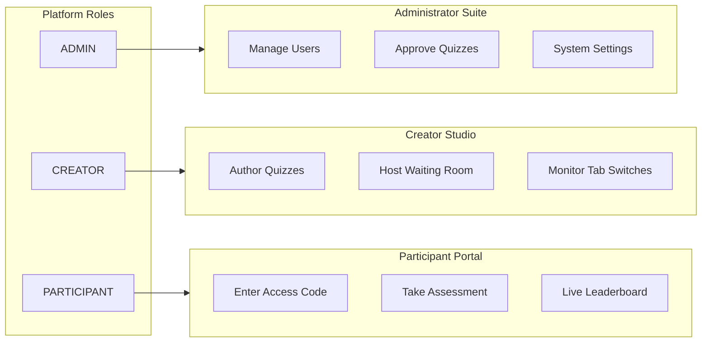
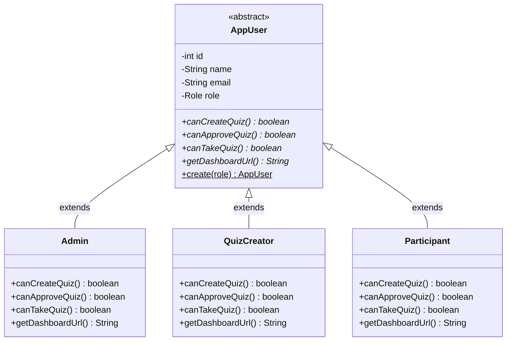
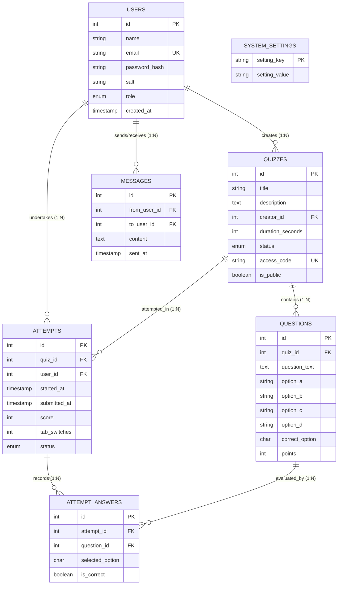
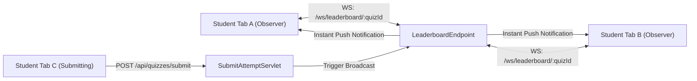

# QuizLive — Enterprise Proctored Real-Time Assessment Platform

[](https://openjdk.org/projects/jdk/21/)
[-1A2B4C?style=for-the-badge&logo=eclipsevert.x&logoColor=white)](https://jakarta.ee/)
[](https://tomcat.apache.org/)
[](https://www.mysql.com/)
[](https://github.com/brettwooldridge/HikariCP)
[](https://jakarta.ee/specifications/websocket/2.1/)
[-brightgreen?style=for-the-badge&logo=junit5&logoColor=white)]()
[](https://www.docker.com/)

> **QuizLive** is a production-grade, high-concurrency, real-time proctored online assessment platform built in pure modern Java (**Jakarta EE 10 / Servlet 6.0**, **WebSocket 2.1**, **HikariCP**, and **Embedded Apache Tomcat 10.1**).  
> Designed with a **Zero-Trust Server-Authoritative Architecture**, QuizLive prevents cheating at the network, client, and protocol layers while delivering sub-second cold starts and live millisecond leaderboard synchronization.

---

## 🏗️ System Architecture & Solution Design

### 1. Problem Statement & Zero-Trust Architecture

Traditional online quiz apps suffer from critical security vulnerabilities:
1. **Answer Key Leakage:** Answers are often bundled in client HTML/JS payloads, easily viewed in F12 DevTools.  
   $\rightarrow$ *QuizLive Solution:* [`Question.sanitized()`](src/main/java/com/quizlive/model/Question.java#L43) strips answer keys before transmission.
2. **Client-Clock Manipulation:** JavaScript timers can be paused or bypassed by altering the OS clock.  
   $\rightarrow$ *QuizLive Solution:* Timers run strictly on background `ScheduledExecutorService` daemon threads on the server.
3. **Unmonitored Academic Dishonesty:** Students switch tabs to look up answers.  
   $\rightarrow$ *QuizLive Solution:* HTML5 Page Visibility API captures defocus events and logs tab switches server-side in real time.
4. **Polling Lag & Database Overload:** Client HTTP polling crashes databases during simultaneous classroom tests.  
   $\rightarrow$ *QuizLive Solution:* Native JSR-356 WebSockets push leaderboard changes to all observers in milliseconds.

---

### 2. High-Level 3-Tier Layered Architecture

QuizLive is engineered cleanly in pure Java on Embedded Tomcat 10.1 without Spring Boot overhead:



---

### 3. End-to-End Quiz Lifecycle Sequence Diagram



---

### 4. Role-Based Access Control (RBAC) Workflows



---

## ☕ Core Java Concepts & OOP Implementation

### 1. OOP Inheritance, Polymorphism & Abstraction



- **Inheritance & Polymorphic Dispatch:** [`AppUser`](src/main/java/com/quizlive/model/AppUser.java#L12) declares abstract methods (`canCreateQuiz()`, `canApproveQuiz()`, `canTakeQuiz()`, `getDashboardUrl()`) implemented specifically by each subclass.
- **Factory Pattern:** `AppUser.create(...)` encapsulates polymorphic instantiation based on the `Role` enum.
- **Interface Abstraction:** The [`Gradeable`](src/main/java/com/quizlive/model/Gradeable.java#L3) interface contract (`computeScore()`, `getPercentage()`, `isPassed()`) is implemented by [`Attempt.java`](src/main/java/com/quizlive/model/Attempt.java#L10), decoupling evaluation logic from UI presentation.
- **Custom Exception Hierarchy:** Custom domain exceptions ([`InvalidAttemptException`](src/main/java/com/quizlive/exception/InvalidAttemptException.java), [`QuizClosedException`](src/main/java/com/quizlive/exception/QuizClosedException.java), [`UnauthorizedException`](src/main/java/com/quizlive/exception/UnauthorizedException.java)) enforce business integrity and translate to clean JSON error payloads.

---

### 2. Collections & Generics

1. **Type-Safe Generics:** Extensive use of `List<Question>`, `List<AttemptAnswer>`, and `Map<Integer, Set<Session>>`.
2. **Multi-Attribute Comparator Chaining:** [`LeaderboardService`](src/main/java/com/quizlive/service/LeaderboardService.java#L22) sorts attempts using a multi-factor comparator:
   ```java
   private static final Comparator<Attempt> RANKING_COMPARATOR = Comparator
           .comparing(Attempt::getScore, Comparator.reverseOrder())
           .thenComparing(Attempt::getDurationSeconds)
           .thenComparing(Attempt::getSubmittedAt, Comparator.nullsLast(Comparator.naturalOrder()));
   ```

---

### 3. Multithreading & Synchronization

1. **Daemon Scheduled Executor:** [`QuizSchedulerService`](src/main/java/com/quizlive/concurrency/QuizSchedulerService.java#L25) manages a pool of 4 named daemon threads scheduling timeout auto-submissions.
2. **Thread-Safe Registries:** Active sessions are stored in a `ConcurrentHashMap<Integer, AttemptSession>` inside [`ActiveAttemptRegistry`](src/main/java/com/quizlive/concurrency/ActiveAttemptRegistry.java#L10).
3. **Lock-Free Atomic Counters:** Tab switches are tracked via `AtomicInteger.incrementAndGet()` in [`AttemptSession`](src/main/java/com/quizlive/concurrency/AttemptSession.java#L16).
4. **Synchronization Locks:** Leaderboard recalculations and timeout handlers are guarded with `synchronized` methods to prevent double-grading race conditions.

---

## 💾 Database Integration & JDBC Operations

### 1. Relational Database Schema & ER Model



---

### 2. Classes for Database Operations (DAO Pattern)

All SQL operations are isolated behind 7 DAO interface contracts:
- [`UserDao`](src/main/java/com/quizlive/dao/UserDao.java) / [`UserDaoImpl`](src/main/java/com/quizlive/dao/impl/UserDaoImpl.java) — User CRUD & authentication
- [`QuizDao`](src/main/java/com/quizlive/dao/QuizDao.java) / [`QuizDaoImpl`](src/main/java/com/quizlive/dao/impl/QuizDaoImpl.java) — Quiz lifecycle & publishing
- [`QuestionDao`](src/main/java/com/quizlive/dao/QuestionDao.java) / [`QuestionDaoImpl`](src/main/java/com/quizlive/dao/impl/QuestionDaoImpl.java) — Batch question inserts & answer sanitization
- [`AttemptDao`](src/main/java/com/quizlive/dao/AttemptDao.java) / [`AttemptDaoImpl`](src/main/java/com/quizlive/dao/impl/AttemptDaoImpl.java) — Exam attempts & proctoring telemetry
- [`AttemptAnswerDao`](src/main/java/com/quizlive/dao/AttemptAnswerDao.java) / [`AttemptAnswerDaoImpl`](src/main/java/com/quizlive/dao/impl/AttemptAnswerDaoImpl.java) — Per-question evaluation logging
- [`MessageDao`](src/main/java/com/quizlive/dao/MessageDao.java) / [`MessageDaoImpl`](src/main/java/com/quizlive/dao/impl/MessageDaoImpl.java) — Instructor/student Q&A threads
- [`SettingsDao`](src/main/java/com/quizlive/dao/SettingsDao.java) / [`SettingsDaoImpl`](src/main/java/com/quizlive/dao/impl/SettingsDaoImpl.java) — System key-value configurations

---

### 3. JDBC Connectivity, HikariCP & ACID Transactions

- **HikariCP 5.1.0 Connection Pool:** Configured in [`DbConnectionUtil.java`](src/main/java/com/quizlive/util/DbConnectionUtil.java#L19) using double-checked locking singleton with prepared statement caching (`cachePrepStmts=true`).
- **100% Parameterized Queries:** Every database query strictly utilizes `PreparedStatement`, eliminating SQL injection risks.
- **ACID Transaction Boundaries:** Multi-row operations in [`QuizDaoImpl.createWithQuestions`](src/main/java/com/quizlive/dao/impl/QuizDaoImpl.java#L77) and [`AttemptDaoImpl.submitAttempt`](src/main/java/com/quizlive/dao/impl/AttemptDaoImpl.java#L144) use `conn.setAutoCommit(false)`, `conn.commit()`, and `conn.rollback()` in `catch (SQLException e)` blocks.

---

## 🌐 Servlets & Web Integration

### 1. Jakarta Servlets & Web Filters

- **16 Jakarta Servlets (`@WebServlet`):** Full REST API coverage for authentication, quiz authoring, host controls, attempt grading, and administration.
- **[`AuthFilter`](src/main/java/com/quizlive/filter/AuthFilter.java#L21):** Intercepts all traffic, validates active HTTP sessions, and whitelists public assets.
- **[`RoleFilter`](src/main/java/com/quizlive/filter/RoleFilter.java#L19):** Enforces strict Role-Based Access Control across `/admin/*`, `/creator/*`, and `/participant/*`.

---

### 2. Real-Time WebSocket Engine (JSR-356)



- **[`LeaderboardEndpoint`](src/main/java/com/quizlive/websocket/LeaderboardEndpoint.java#L23):** Real-time push updates broadcast score and rank recalculations without client polling.
- **[`WaitingRoomEndpoint`](src/main/java/com/quizlive/websocket/WaitingRoomEndpoint.java#L27):** Live lobby synchronizes waiting student counters and initiates instant exam redirection.

---

## 🧪 Automated Test Suite (111 / 111 Tests Passing)

QuizLive includes **111 automated tests** verifying unit logic, JDBC DAOs, concurrency executors, and end-to-end browser flows:

```
[INFO] -------------------------------------------------------
[INFO]  T E S T S
[INFO] -------------------------------------------------------
[INFO] Running com.quizlive.ActiveAttemptRegistryTest          (3 tests  - PASSED)
[INFO] Running com.quizlive.AdminAndMessagingServletTest        (5 tests  - PASSED)
[INFO] Running com.quizlive.AppLauncherAndHealthTest           (2 tests  - PASSED)
[INFO] Running com.quizlive.AttemptDaoTest                     (3 tests  - PASSED)
[INFO] Running com.quizlive.AttemptModelTest                   (2 tests  - PASSED)
[INFO] Running com.quizlive.AuthServiceTest                    (6 tests  - PASSED)
[INFO] Running com.quizlive.AuthServletTest                    (11 tests - PASSED)
[INFO] Running com.quizlive.BrowserAndEndToEndVerificationTest (1 test   - PASSED)
[INFO] Running com.quizlive.CreatorRankAndQuizCodeTest         (15 tests - PASSED)
[INFO] Running com.quizlive.DbConnectionTest                   (2 tests  - PASSED)
[INFO] Running com.quizlive.EnumsAndExceptionsTest             (3 tests  - PASSED)
[INFO] Running com.quizlive.EnvConfigTest                      (5 tests  - PASSED)
[INFO] Running com.quizlive.JsonUtilAndFilterTest              (2 tests  - PASSED)
[INFO] Running com.quizlive.LeaderboardAndAttemptServletTest   (7 tests  - PASSED)
[INFO] Running com.quizlive.LeaderboardEndpointTest            (5 tests  - PASSED)
[INFO] Running com.quizlive.LeaderboardServiceTest             (2 tests  - PASSED)
[INFO] Running com.quizlive.MessageAndSettingsDaoTest          (2 tests  - PASSED)
[INFO] Running com.quizlive.PasswordUtilTest                   (3 tests  - PASSED)
[INFO] Running com.quizlive.QuizAndQuestionModelTest           (3 tests  - PASSED)
[INFO] Running com.quizlive.QuizAndScoringServiceTest          (3 tests  - PASSED)
[INFO] Running com.quizlive.QuizAttemptLifecycleServletTest    (2 tests  - PASSED)
[INFO] Running com.quizlive.QuizDaoTest                        (3 tests  - PASSED)
[INFO] Running com.quizlive.QuizManagementServletTest          (7 tests  - PASSED)
[INFO] Running com.quizlive.QuizSchedulerServiceTest           (2 tests  - PASSED)
[INFO] Running com.quizlive.UserDaoTest                        (4 tests  - PASSED)
[INFO] Running com.quizlive.UserHierarchyTest                  (2 tests  - PASSED)
[INFO] Running com.quizlive.WaitingRoomAndHostTest             (6 tests  - PASSED)
[INFO] 
[INFO] Results: Tests run: 111, Failures: 0, Errors: 0, Skipped: 0
[INFO] BUILD SUCCESS
```

---

## 🚀 Quick Start & Installation Guide

### Prerequisites
- JDK 21 LTS installed (`java -version`)
- MySQL 8.0+ running locally OR Docker Desktop

### Local Execution (Maven Wrapper)
```bash
# 1. Clone & Setup Environment
git clone https://github.com/Amritesh-Singh-okay/QuizLive-.git
cd QuizLive-
cp .env.example .env

# 2. Run Test Suite (111 Tests)
.\mvnw.cmd test          # Windows
./mvnw test              # Linux / macOS

# 3. Launch Embedded Tomcat Server
.\mvnw.cmd compile exec:java   # Windows
./mvnw compile exec:java       # Linux / macOS
```
- Web Application: **`http://localhost:8080/quizlive`**
- Health Diagnostic: **`http://localhost:8080/quizlive/health`**

### Docker Deployment
```bash
docker compose up -d --build
```
Access at: **`http://localhost:8080`**

---

## 👥 Demo Credentials & Live Evaluator Script

All accounts share the default password: **`password123`**

| Role | Email Address | Password | Permissions & Dashboard |
|---|---|---|---|
| **System Administrator** | `admin@quizlive.com` | `password123` | Approves quizzes, manages users, system settings |
| **Quiz Creator** | `creator@quizlive.com` | `password123` | Authors quizzes, hosts live lobbies, tracks proctoring |
| **Student Participant 1** | `alice@quizlive.com` | `password123` | Joins waiting rooms, takes exams, views ranks |
| **Student Participant 2** | `bob@quizlive.com` | `password123` | Multi-user competition and live leaderboard tests |

### 5-Minute Evaluator Demonstration
1. **Admin Approval (OOP & RBAC):** Login as `admin@quizlive.com` $\rightarrow$ Approve pending quizzes in the approval queue.
2. **Creator Host & Waiting Room (WebSockets):** Login as `creator@quizlive.com` $\rightarrow$ Click **Host Live Quiz** on *"Core Java Fundamentals"* (Code: `JAVA101`).
3. **Student Joining & Proctoring (Anti-Cheat):** In another window, login as `alice@quizlive.com` $\rightarrow$ Enter code `JAVA101`. Watch the creator's student counter increment in real time. Creator clicks **Start Quiz** $\rightarrow$ Alice's screen transitions automatically. Switch tabs to test proctoring telemetry.
4. **Instant WebSocket Leaderboard (Concurrency):** Open `/leaderboard.jsp?quizId=1` in a separate tab. Submit Alice's exam and observe the live ranking update instantly without page reload.

---

## 📜 License

This project is licensed under the **MIT License**.
